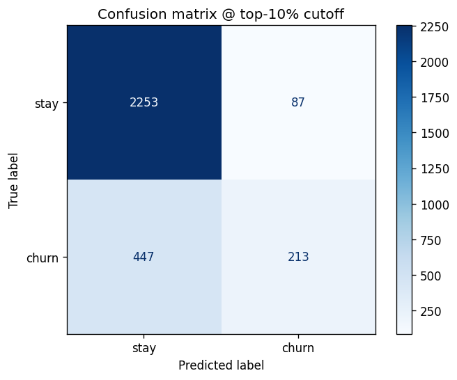
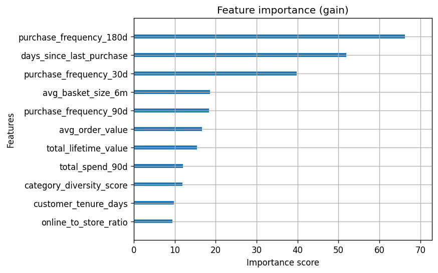

# Lab 3 — Churn Model Evaluation Report

Graded run: `final-depth6-autoweight` · MLflow run aa374bd3… · Registry v6 (PendingManualApproval)
XGBoost 3.2.0 · seed 42 · 6,999 train / 3,000 test (stratified 70/30) · data from Feature Store via Athena (query 20de0237…)

## 1. Metrics vs thresholds
| Metric | Value | Threshold | Result |
|---|---|---|---|
| AUC-ROC | 0.7804 | none (reported only) | – |
| Precision@10% | 0.7100 | ≥ 0.50 | PASS |
| Recall@10% | 0.3227 | ≥ 0.25 | PASS |
| AUC lift vs baseline, 95% CI | [0.0373, 0.0756] | must exclude 0 | PASS |

The confidence interval replaced the AUC threshold since we want to base our insights on analysis and not on luck. The same model's AUC moves up and down depending on which customers land in the test set, so AUC >= 0.72 was basically grading luck. That's the reason we have the CI: the confidence interval tells us with 95% confidence that the model is better than the simple rule.

## 2. Baseline comparison
| Model | AUC |
|---|---|
| Recency only (simple rule, `churn_risk_score`) | 0.7233 |
| Full model (XGBoost, 11 features) | 0.7804 |
| **Lift** | **+0.0571** |
| 95% CI (paired bootstrap, 2,000 resamples) | [0.0373, 0.0756] |

I can confidently claim that the model ranks churners better than the simple rule, and this is backed by numbers: by at least 0.037 AUC. Honestly, it is a modest improvement, not a huge one, but it can help us reach the right people and offer them the right promotions and discounts. NorthStar wants the top 10% contact list filled with real churners, not people who will stay anyway and do not need to be reached out to. Since some customers are easier to predict than others, the bootstrap is paired: the model and the simple rule are scored on the same customers in every resample, so the comparison is fair. An example would be two students taking different exams: there is no way to compare who did better unless they take the same exam.

## 3. Experiments (MLflow)
| Run | Change | AUC | P@10 | R@10 |
|---|---|---|---|---|
| exp1-default | max_depth 6, scale_pos_weight 3.54 (auto) | 0.7804 | 0.7100 | 0.3227 |
| exp2-shallow | max_depth 3 | 0.7802 | 0.7167 | 0.3258 |
| exp3-no-weight | scale_pos_weight 1.0 | 0.7805 | 0.7033 | 0.3197 |
| **final-depth6-autoweight** (graded) | same as exp1 | 0.7804 | 0.7100 | 0.3227 |

All three runs are within about 0.003 AUC of each other, which is much smaller than the CI width (about 0.04), so the differences are noise and not real wins. I went with depth 6 because it trained faster (early stopping at round 29 vs 104 for depth 3) and uses the default parameters, but it is not necessarily better since it got the same score as depth 3. Depth 6 has a train AUC of 0.861 vs 0.780 on validation; this gap of 0.08 means the model memorized some noise from the training data that does not carry over to new customers (some overfitting). On top of that, weighting matters only depending on how you pick who to contact: if you contact the top 10%, it won't matter since the order stays the same, but if your threshold is, let's say, above 0.5, then weighting could make multiple customers cross the line.

## 4. Confusion matrix @ top-10% cutoff

| | Not contacted | Contacted (top 300) |
|---|---|---|
| **Actually stayed** | 2,253 (true negative) | 87 (false positive) |
| **Actually churned** | 447 (false negative) | 213 (true positive) |

The cutoff is the top 10% of scores (300 of 3,000 test customers), not a fixed score like 0.5. The reason is resource limitations: we are on a budget, so we cannot reach every customer the model picks as a possible churner, only those with the highest chance of being a real churner. The 87 false positives are customers who got an offer but would have stayed anyway, and the 447 false negatives are churners we missed. The 447 is where the money is: at about $340 lifetime value each, that is roughly $152K lost, while the 87 only cost a discount each. With only 300 spots and 660 churners, even a perfect model would miss at least 360, so most of the 447 misses come from the budget and only 87 from the model.

## 5. Feature importance

The top 3 features by gain are `purchase_frequency_180d` (~66), `days_since_last_purchase` (~52) and `purchase_frequency_30d` (~40). They are all buying-activity features: how often and how recently a customer buys. `days_since_last_purchase` is the same recency feature the simple rule uses, which is why the simple rule already scored 0.72: it is based on a high-gain feature the model takes into account too. The model adds the other buying-activity features on top, and that is where the extra 0.057 AUC comes from. The weakest features are `online_to_store_ratio`, `customer_tenure_days` and `category_diversity_score` (~9-12); low gain does not mean useless, since they might still add a small insight on top of the big ones. Gain shows how useful a feature is, not the direction it pushes the score.

## 6. Slice evaluation
| Tier | n | Churners | Churn rate | AUC | Recall@10% | Too small? | Flag |
|---|---|---|---|---|---|---|---|
| Bronze | 1,071 | 361 | 34% | 0.756 | 0.449 | No | – |
| Silver | 1,139 | 226 | 20% | 0.711 | 0.190 | No | ⚠ |
| Gold | 483 | 52 | 11% | 0.744 | 0.115 | No | ⚠ |
| Platinum | 307 | 21 | 7% | 0.883 | 0.095 | Yes (21 < 30) | – |

Flag rule: tier recall@10% more than 10 points below the overall 0.32 (below 0.22), for tiers with at least 30 churners.

All tiers compete for the same top 10% contact spots. Bronze churns about 3x more than Gold (34% vs 11%), so Bronze customers get the highest scores and take most of the spots: 162 of the 213 churners we caught are Bronze. Gold and Silver are both flagged, but for different reasons. Gold has an OK AUC (0.744, close to Bronze) but low recall (0.115), so the model ranks Gold customers fine; Gold just gets too few spots. That is a budget problem. Silver has the lowest AUC of the tiers we can trust (0.711), so the model has a harder time telling Silver churners from stayers. That is a model problem. Fixes: for Gold, give each tier its own share of the contact spots (like a recruiter for each tier), so Gold does not have to compete with Bronze for the same list. For Silver, add new features that capture what is different about Silver customers, so the model gets better at telling Silver churners from stayers.

Platinum is marked too small: it has only 21 churners, under the 30 minimum, so its AUC of 0.883 is not trustworthy. The threshold is picked so random noise is clearly smaller than the drop we are trying to detect (noise ≈ √(p(1−p)/churners)). With 21 churners, one person moves recall by about 5 points, so about 2 people can cause a flag. "Too small to judge" is itself a finding: Platinum is the most valuable tier, and "we need more data" is important to report, not hide.